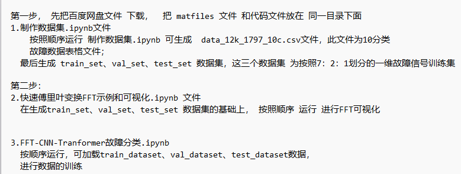
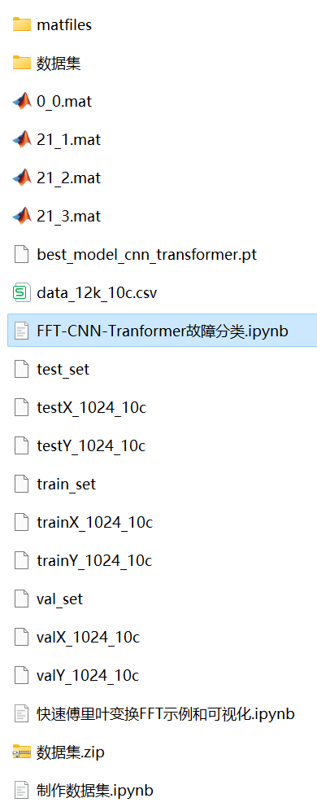

# Bearing Fault Identification Model with Time-Domain and Frequency-Domain Feature Fusion Using FFT+CNN-Transformer

The family bucket includes the following content:
- Thesis Innovation!!!
- Includes a complete bearing fault dataset, as well as pre-generated fault signal datasets, classification data, and label sets. All corresponding codes are executable, along with an example of Fast Fourier Transform (FFT).
- 50 epochs, with 100% accuracy. The FFT+CNN-Transformer network achieves significant results in classification, allowing the model to fully extract spatial, temporal, and frequency domain features from bearing fault signals. It converges quickly and performs exceptionally well, currently being the most accurate method among previous articles. The innovation is also notable!
- Including code for data preprocessing and the FFT+CNN-Transformer classification.
- Environment: Python 3.9

\n\n\n\n\n\n\n\n\n\n\n\n\n\n\n\n\n\n\n\n\n\n\n\n\n\n\n\n\n\n\n\n\n\n\n\n\n\n\n\n\n\n\n\n\n\n\n\n\n\n\n\n\n\n\n\n\n\n\n\n\n\n\n\n\n\n\n\n\n\n\n\n\n\n\n\n\n\n\n\n\n\n\n\n\n\n\n\n\n\n\n\n\n\n\n\n\n\n\n\n\n\n\n\n\n\n\n\n\n\n\n\n\n\n\n\n\n\n\n\n\n\n\n\n\n\n\n\n\n\n\n\n\n\n\n\n\n\n\n\n\n\n\n\n\n\n\n\n\n\n\n\n\n\n\n\n\n\n\n\n\n\n\n\n\n\n\n\n\n\n\n\n\n\n\n\n\n\n\n\n\n\n\n\n\n\n\n\n\n\n\n\n\n\n\n\n\n\n\n\n\n\n\n\n\n\n

## Images

<!-- PAYMENT_BLOCK -->

## Get this dataset

- Payment link (Stripe): [Buy now](https://buy.stripe.com/3cs8yP7sY87d0vu9AB)
- Payment QR code: 

<!-- /PAYMENT_BLOCK -->
